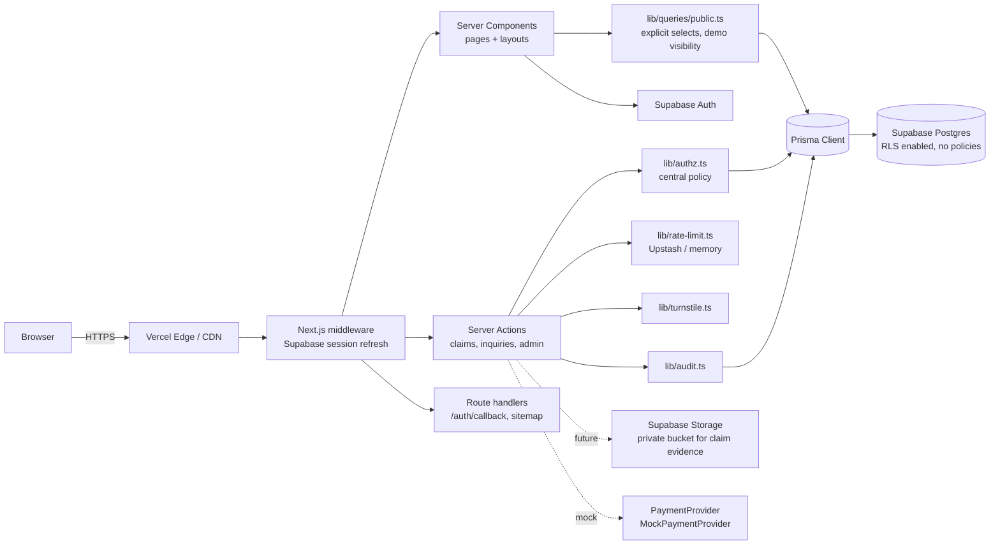

# System architecture

## Key decisions

### 1. Authorization: central policy layer + RLS as defense in depth
Prisma connects as the table owner and **bypasses Row Level Security**. Therefore:
- `src/lib/authz.ts` is the **primary** access control: a pure role × action matrix (`can`, `assertCan`) unit-tested in isolation.
- Every server action calls `requireAction(...)`; every admin page calls `requirePageAccess(...)` (admin layout + each page).
- Migration `…_enable_rls` enables RLS on **every** table with **no policies**, so Supabase's auto-generated Data API (anon / authenticated keys) can read and write nothing. Any future direct Supabase-client feature must add narrowly scoped policies.
- Risk: a new query path that forgets the policy layer is not caught by the database. Mitigation: public reads only through `lib/queries/public.ts`; lint/review rule; integration tests for leaks.

### 2. Public query layer
`src/lib/queries/public.ts` is the only module pages use to read public data. Every function uses an explicit `select` (no financials, emails, evidence, private notes), filters `status = ACTIVE`, and applies the admin's demo-visibility setting. `tests/unit/data.test.ts` asserts no private keys leak.

### 3. Authentication
- `AUTH_MODE=supabase` (deployed): passwordless magic link via `@supabase/ssr`; `/auth/callback` exchanges the code; middleware refreshes the session cookie; first sign-in creates the app `User` (role USER).
- `AUTH_MODE=dev` (local only): pick a seeded DEMO user, signed HS256 JWT cookie (`jose`, 8 h, httpOnly, SameSite=Lax). Refused when `VERCEL` is set or in production builds, except a local production build with `DEV_AUTH_LOCAL_TEST=1` (used by e2e). Covered by unit tests.

### 4. Rendering
All data pages render per request (`connection()` / `cookies()`), so moderation and demo-visibility changes are immediate and nothing user-specific is baked at build time. Trade-off: no ISR yet (see RISKS.md).

### 5. Search
Postgres `ILIKE` with `pg_trgm` GIN indexes on names. A `SearchProvider` interface allows Meilisearch/Typesense later without changing pages.

### 6. Advertising pipeline (milestone 2, schema in place)
`AdPlacement` (fixed price, capacity) → `Campaign` (dates, status, admin approval) → `Advertisement` (creative, review status) → `Impression` / `Click` (append-only, hashed session + IP, `isFiltered` + reason). Impression = ≥50 % visible ≥1 s via IntersectionObserver, batched beacon; click = server redirect endpoint that logs then redirects. Dedupe window, bot UA filtering, Turnstile on suspicious traffic, admin/advertiser self-views excluded.

### 7. Provider interfaces (`src/lib/providers`)
`PaymentProvider` (mock only), `EscrowProvider` (throws — out of scope), `VerificationProvider` (manual), `KycProvider`, `SearchProvider`. Real Stripe requires explicit approval + security review.

### 8. Security controls (implemented)
CSP and security headers (`next.config.ts`), Zod on every input, same-site redirect validation (`safeNext`), rate limiting, Turnstile hooks, salted IP hashing, audit log on every moderation/verification/settings/auth event, React output escaping, JSON-LD escaping, `poweredByHeader: false`.

### 9. Observability
`app/error.tsx` is the hook point for Sentry (`SENTRY_DSN`); not wired in milestone 1.
